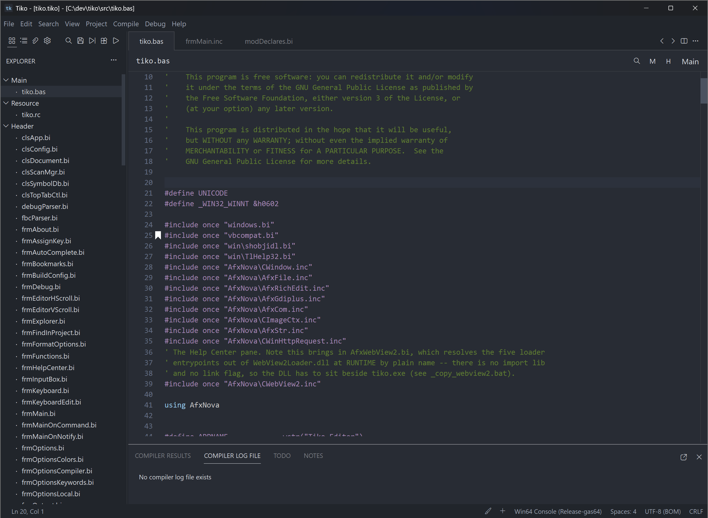
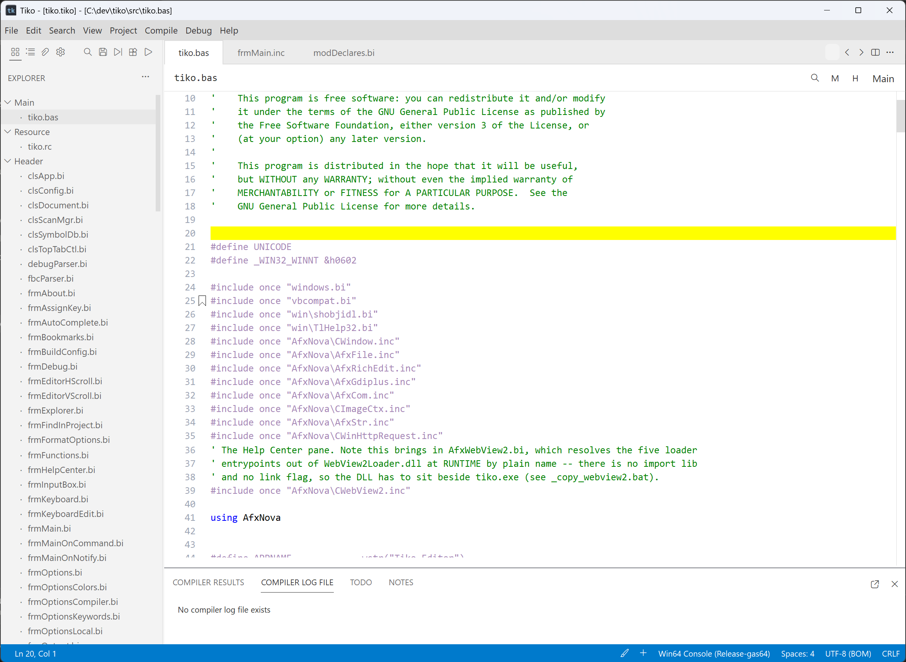

# tiko editor

## Programmer's Code Editor for the FreeBASIC Compiler

⚠️⚠️ <mark>NOTE: This project has been superseded by https://github.com/PaulSquires/tiko-lang which includes a great code editor and built in visual designer.</mark> ⚠️⚠️

Tiko is a small, fast, and easy to use code editor.

Tiko is an all-in-one package including the latest Tiko editor, FreeBASIC compiler (32 and 64 bit compilers), Jose Roca's WinFBX (AFX) library, several Help files and all the necessary compiler Include files.

Includes the complete FreeBASIC compiler and toolchain. Tiko Editor is preconfigured to work perfectly with the included compiler toolchain thus enabling you to be immediately productive with the FreeBASIC language. 

Source code is written using the FreeBASIC language and uses the Scintilla editing library (in 64 bit DLL form).

Features:

- Unicode enabled.
- 64 bit version.
- High DPI aware for any monitor resolution.
- Language localization. Simple create language file based on English.lang file.
- Localized for 6 languages:
- - English, French, Spanish, German, Norwegian, Chinese Simplified
- Projects and non-project based editing.
- Easy integration of Console or GUI based code.
- Incremental compiling of code defined as a "module".
- Easy including of Windows Resource files simply by specifying which source code file is the resource.
- Seamless integration of the FreeBasic Compiler (both 32 bit and 64 bit).
- Codetip popups and auto completion.
- Basic Debugger integration with GDB.

Tiko is the replacement for the WinFBE Editor https://github.com/PaulSquires/WinFBE project which will soon be deprecated. 

**Requirements:**
- Windows 10 or later operating system because many newer API's are used in the source code.

tiko editor - Programmer's Code Editor for the FreeBASIC Compiler
Copyright (C) 2016-2026 Paul Squires, PlanetSquires Software

The tiko editor is licensed under the GNU GPLv3 or later.

